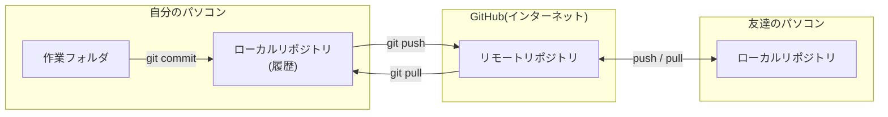

# 0. Git と GitHub ってなに?

## こんな経験はありませんか?

```
レポート.docx
レポート_修正.docx
レポート_修正2.docx
レポート_最終.docx
レポート_最終_本当に最終.docx
```

ファイルをコピーして名前を変えながら「履歴」を残すやり方は、すぐに破綻します。

- どれが最新かわからない
- 「2つ前の版のあの段落」に戻したいとき、どのファイルか探せない
- 友達と同じファイルを同時に編集すると、どちらかの変更が消える

これを解決するのが **バージョン管理システム** です。

## Git とは

**Git** は、ファイルの変更履歴を記録・管理するためのソフトウェアです。自分のパソコンにインストールして使います。

- 変更を「**コミット**」という単位でセーブポイントのように記録する
- いつ・誰が・何を・なぜ変えたかが残る
- 過去の状態にいつでも戻れる
- 複数の作業を並行して進め(**ブランチ**)、あとで合体(**マージ**)できる

ゲームのセーブデータをイメージするとわかりやすいです。好きなタイミングでセーブして、失敗したらロードし直せます。

## GitHub とは

**GitHub** は、Git で管理しているデータ(**リポジトリ**)をインターネット上に置いておけるサービスです。

- パソコンが壊れても、GitHub にあるデータは無事
- 他の人と共有して、一緒に開発できる
- **プルリクエスト**(変更の提案)や **Issue**(課題管理)など、チーム開発のための機能がある
- 世界中の公開されたコードを読める

## Git と GitHub の関係



| | Git | GitHub |
| --- | --- | --- |
| 何か | ソフトウェア(ツール) | Web サービス |
| どこで動く | 自分のパソコン | インターネット上 |
| 主な役割 | 履歴を記録する | 履歴を共有・公開する、チームで開発する |
| ネットなしで使える? | 使える | 使えない |

💡 **ポイント**: Git だけでも履歴管理はできます。GitHub はその履歴を「共有する場所」です。似たサービスに GitLab や Bitbucket がありますが、どれも中身は Git です。

## この教材で使う言葉

| 言葉 | ざっくりした意味 |
| --- | --- |
| リポジトリ (repository) | 履歴つきのプロジェクトフォルダ。略して「リポ」「レポ」 |
| コミット (commit) | 変更を記録したセーブポイント |
| ブランチ (branch) | 作業の分かれ道 |
| プッシュ (push) | 手元の履歴を GitHub に送る |
| プル (pull) | GitHub の履歴を手元に取り込む |
| プルリクエスト (pull request, PR) | 「この変更を取り込んでください」という提案 |

全部を今覚える必要はありません。困ったら[用語集](glossary.md)を見てください。

---

[次へ: 1. 準備 →](01-setup.md)
