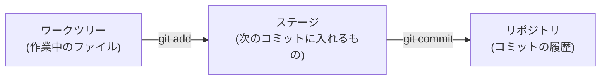

# 2. Git の基本

この章では GitHub はまだ使いません。自分のパソコンの中だけで、Git で履歴を記録する流れを体験します。

## 2-1. 3つの場所

Git を理解するうえでいちばん大事なのが、次の **3つの場所** です。



| 場所 | 説明 | たとえ |
| --- | --- | --- |
| ワークツリー | 実際に編集しているファイル | 机の上の書きかけの原稿 |
| ステージ(インデックス) | 次のコミットに含める変更を置いておく場所 | 提出用の封筒 |
| リポジトリ | コミットとして記録された履歴 | 提出済みの書類の保管庫 |

「なんでいきなりコミットしないで `add` を挟むの?」と思うかもしれません。これは **変更の一部だけを選んでコミットできる** ようにするためです。たとえば、3つのファイルを編集したけど、そのうち2つだけを「ログイン機能の追加」としてまとめて記録したい、ということができます。

## 2-2. リポジトリを作る

練習用のフォルダを作って、その中に移動します。

```console
$ mkdir git-practice
$ cd git-practice
```

このフォルダを Git で管理できるようにします。

```console
$ git init
Initialized empty Git repository in /Users/taro/git-practice/.git/
```

`.git` という隠しフォルダができました。履歴はすべてここに保存されます。

⚠️ **注意**: `.git` フォルダを消すと履歴が全部消えます。手で触らないようにしましょう。

## 2-3. 状態を確認する: `git status`

```console
$ git status
On branch main

No commits yet

nothing to commit (create/copy files and use "git add" to track)
```

`git status` は **いつでも何度でも打っていい** コマンドです。迷ったらまず `git status`。

## 2-4. 最初のコミット

`profile.md` というファイルを作り、エディタで次のように書いて保存します。

```markdown
# 自己紹介

名前: 山田太郎
```

コマンドで作るならこうです。

```console
$ echo "# 自己紹介" > profile.md
$ echo "" >> profile.md
$ echo "名前: 山田太郎" >> profile.md
```

状態を見てみます。

```console
$ git status
On branch main

No commits yet

Untracked files:
  (use "git add <file>..." to include in what will be committed)
	profile.md

nothing added to commit but untracked files present (use "git add" to track)
```

`Untracked files`(Git がまだ追跡していないファイル)として表示されています。ステージに追加します。

```console
$ git add profile.md
$ git status
On branch main

No commits yet

Changes to be committed:
  (use "git rm --cached <file>..." to unstage)
	new file:   profile.md
```

`Changes to be committed`(コミットされる変更)に移りました。コミットします。

```console
$ git commit -m "自己紹介ファイルを追加"
[main (root-commit) 3f2a1b9] 自己紹介ファイルを追加
 1 file changed, 3 insertions(+)
 create mode 100644 profile.md
```

`-m` のあとに書いたのが **コミットメッセージ** です。これで最初のセーブポイントができました 🎉

## 2-5. 変更を記録する

`profile.md` に1行追加します。

```markdown
# 自己紹介

名前: 山田太郎
趣味: ゲーム
```

何が変わったかは `git diff` で確認できます。

```console
$ git diff
diff --git a/profile.md b/profile.md
index 1a2b3c4..5d6e7f8 100644
--- a/profile.md
+++ b/profile.md
@@ -1,3 +1,4 @@
 # 自己紹介
 
 名前: 山田太郎
+趣味: ゲーム
```

`+` で始まる行が追加された行、`-` で始まる行が削除された行です。

確認できたら、ステージに追加してコミットします。

```console
$ git add profile.md
$ git commit -m "趣味を追加"
```

💡 **ポイント**: `git add .` と書くと、今いるフォルダ以下の変更をまとめてステージに追加できます。便利ですが、意図しないファイル(パスワードを書いたファイルなど)まで入れてしまわないよう、`git status` で確認してからにしましょう。

## 2-6. 履歴を見る: `git log`

```console
$ git log
commit 8c7d6e5f4a3b2c1d0e9f8a7b6c5d4e3f2a1b0c9d (HEAD -> main)
Author: Taro Yamada <taro@example.com>
Date:   Mon Apr 14 10:05:00 2025 +0900

    趣味を追加

commit 3f2a1b9c8d7e6f5a4b3c2d1e0f9a8b7c6d5e4f3a
Author: Taro Yamada <taro@example.com>
Date:   Mon Apr 14 10:00:00 2025 +0900

    自己紹介ファイルを追加
```

1行ずつ短く表示するなら `--oneline` をつけます。

```console
$ git log --oneline
8c7d6e5 (HEAD -> main) 趣味を追加
3f2a1b9 自己紹介ファイルを追加
```

左の英数字(`8c7d6e5` など)は **コミット ID**(ハッシュ)と呼ばれる、コミットごとの固有の番号です。

💡 **ポイント**: `git log` の表示が長くて画面が止まったら、`q` キーで抜けられます。

## 2-7. 良いコミットメッセージ

コミットメッセージは、未来の自分やチームメンバーへの手紙です。

| ❌ よくない例 | ✅ 良い例 |
| --- | --- |
| `修正` | `ログイン画面のボタンの色を修正` |
| `aaa` | `README にインストール手順を追加` |
| `いろいろ` | (いろいろなら、コミットを分ける) |

- **何をしたか** が一目でわかるように書く
- 1つのコミットには **1つの目的** の変更だけを入れる

## 🧪 やってみよう

1. `profile.md` に「好きな食べ物」を追加してコミットする
2. 新しいファイル `todo.md` を作り、やりたいことを3つ書いてコミットする
3. `git log --oneline` で、コミットが4つ並んでいることを確認する
4. `profile.md` と `todo.md` の両方を編集してから、`profile.md` **だけ** をコミットしてみる(`git add profile.md`)。そのあと `git status` を見て、`todo.md` の変更が残っていることを確認する

## まとめ

```console
$ git init                 # リポジトリを作る(最初の1回)
$ git status               # 状態を確認(迷ったらこれ)
$ git diff                 # 変更内容を確認
$ git add ファイル名        # ステージに追加
$ git commit -m "メッセージ" # コミット
$ git log --oneline        # 履歴を見る
```

基本は **編集 → `add` → `commit`** の繰り返しです。

---

[← 前へ: 1. 準備](01-setup.md) | [次へ: 3. GitHub とつなぐ →](03-remote.md)
