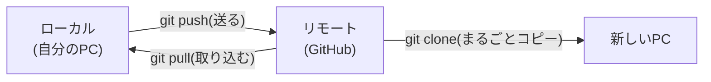

# 3. GitHub とつなぐ

第2章で作ったローカルリポジトリを GitHub にアップロードします。

## 3-1. ローカルとリモート

- **ローカルリポジトリ**: 自分のパソコンの中にあるリポジトリ
- **リモートリポジトリ**: GitHub など、ネットワークの向こうにあるリポジトリ



## 3-2. GitHub にリポジトリを作る

1. GitHub の右上の **+** → **New repository** をクリック
2. 次のように入力する
   - **Repository name**: `git-practice`
   - **Public / Private**: どちらでも OK(練習なら Private でも)
   - **Add a README file などのチェックは入れない**(空のリポジトリにする)
3. **Create repository** をクリック

⚠️ **注意**: 手元にすでにリポジトリがある場合、GitHub 側で README などを作ってしまうと、履歴が食い違って push できなくなります。今回は空のまま作りましょう。

作成すると、次のような URL が表示されます。

```
https://github.com/ユーザー名/git-practice.git
```

## 3-3. リモートを登録して push する

第2章の `git-practice` フォルダで、次を実行します。

```console
$ git remote add origin https://github.com/ユーザー名/git-practice.git
```

これは「`origin` という名前で、この URL をリモートとして登録する」という意味です。`origin` はリモートにつける名前の慣習で、ほとんどの場合これを使います。

登録できたか確認します。

```console
$ git remote -v
origin	https://github.com/ユーザー名/git-practice.git (fetch)
origin	https://github.com/ユーザー名/git-practice.git (push)
```

push します。

```console
$ git push -u origin main
```

`-u` は「今後このブランチは `origin` の `main` とひもづける」という設定です。**最初の1回だけ** つければ、2回目からは `git push` だけで済みます。

GitHub のページを再読み込みすると、`profile.md` が表示されているはずです 🎉

💡 **ポイント**: GitHub の画面で **Commits**(時計のアイコン)をクリックすると、手元で作ったコミットの履歴がそのまま見られます。

## 3-4. 変更して、また push する

`profile.md` を編集してコミットし、push します。

```console
$ git add profile.md
$ git commit -m "出身地を追加"
$ git push
```

いつもの流れが **編集 → `add` → `commit` → `push`** になりました。

## 3-5. clone: GitHub からまるごとコピーする

別のパソコンで作業したいときや、他の人のリポジトリを手元に持ってきたいときは `git clone` を使います。

```console
$ cd ..
$ git clone https://github.com/ユーザー名/git-practice.git git-practice-2
$ cd git-practice-2
$ git log --oneline
```

`git-practice-2` というフォルダに、履歴ごとコピーされました。clone したリポジトリには最初から `origin` が登録されているので、`git remote add` は不要です。

## 3-6. pull: GitHub の変更を取り込む

GitHub 上で直接ファイルを編集することもできます。

1. GitHub で `profile.md` を開き、右上の鉛筆アイコン(Edit)をクリック
2. 1行追加して、**Commit changes...** をクリック

この変更はまだ手元にはありません。取り込みます。

```console
$ git pull
```

`profile.md` を開くと、GitHub で追加した行が反映されています。

💡 **ポイント**: 作業を始める前に `git pull` する癖をつけましょう。他の人(や別のパソコンの自分)が push した変更を先に取り込んでおくと、あとで衝突しにくくなります。

## 🧪 やってみよう

1. `git-practice` を GitHub に push する
2. GitHub 上で `todo.md` を編集してコミットする
3. 手元で `git pull` して、変更が反映されたことを確認する
4. 別のフォルダに `git clone` して、そちらで変更 → commit → push する。元の `git-practice` フォルダで `git pull` して取り込めることを確認する

## まとめ

```console
$ git remote add origin URL   # リモートを登録(最初の1回)
$ git push -u origin main     # 最初の push
$ git push                    # 2回目以降の push
$ git pull                    # リモートの変更を取り込む
$ git clone URL               # リポジトリをまるごとコピー
```

---

[← 前へ: 2. Git の基本](02-git-basics.md) | [次へ: 4. ブランチ →](04-branch.md)
