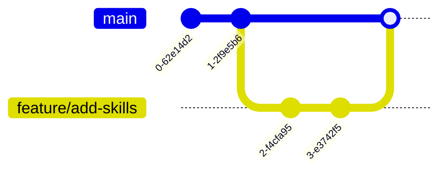

# 4. ブランチ



| 用語 | 意味 |
| --- | --- |
| ブランチ | 履歴の分かれ道。`main` は完成版として置いておき、作業は別のブランチでする |
| マージ | ブランチを合流させる |
| コンフリクト | 同じ行が別々に変更されていて、自動でマージできない状態 |

## 基本操作

```console
$ git switch -c feature/add-skills   # ブランチを作って切り替える
（編集して add / commit）
$ git switch main                    # main に戻る
$ git merge feature/add-skills       # main に取り込む
$ git branch -d feature/add-skills   # 使い終わったブランチを消す
```

`git branch` でブランチ一覧が見られます(`*` が今いるブランチ)。

## コンフリクトの解決

マージでコンフリクトすると、ファイルがこうなります。

```
<<<<<<< HEAD
名前: Taro Yamada
=======
名前: やまだ たろう
>>>>>>> change-name
```

上が今のブランチ、下が取り込もうとしたブランチの内容です。残したい形に書き換え、**記号の行も消して** から、`add` → `commit` します。

```console
$ git add profile.md
$ git commit -m "コンフリクトを解決"
```

やめたいときは `git merge --abort` でマージ前に戻れます。

## 🧪 やってみよう

1. ブランチを作ってコミットし、`main` にマージする
2. 2つのブランチで同じ行を別々に変更してマージし、コンフリクトを解決する

---

[← 前へ: 3. GitHub とつなぐ](03-remote.md) | [次へ: 5. プルリクエスト →](05-pull-request.md)
