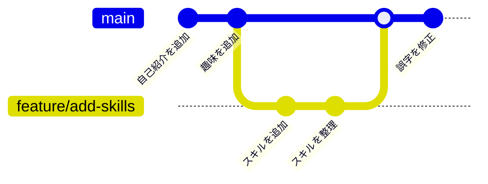

# 4. ブランチ

## 4-1. ブランチとは

**ブランチ**(branch = 枝)は、履歴の分かれ道です。



- `main` ブランチは「いつでも動く・完成している版」として置いておく
- 新しい機能や実験は、`main` から分かれたブランチで作業する
- 完成したら `main` に **マージ**(合流)する

こうしておけば、作業途中で失敗しても `main` は壊れません。チームで開発するときは、メンバーそれぞれが別のブランチで作業することで、お互いの作業を邪魔せずに進められます。

## 4-2. ブランチを作って切り替える

今あるブランチを確認します。`*` がついているのが今いるブランチです。

```console
$ git branch
* main
```

新しいブランチを作って、そこに切り替えます。

```console
$ git switch -c feature/add-skills
Switched to a new branch 'feature/add-skills'
```

`-c` は「create(作る)」の意味です。すでにあるブランチに切り替えるだけなら `-c` は不要です。

```console
$ git branch
* feature/add-skills
  main
```

💡 **ポイント**: 古い資料では `git checkout -b ブランチ名` と書かれていることがあります。これは `git switch -c` と同じ意味です。`checkout` は機能が多すぎて混乱しやすいので、今はブランチの切り替えには `switch` を使うのがおすすめです。

## 4-3. ブランチで作業する

`skills.md` を作ってコミットします。

```markdown
# スキル

- Python
- HTML
```

```console
$ git add skills.md
$ git commit -m "スキル一覧を追加"
```

ここで `main` に切り替えてみます。

```console
$ git switch main
$ ls
profile.md  todo.md
```

`skills.md` がありません! `feature/add-skills` ブランチでした変更は、`main` には影響していないことがわかります。もう一度戻ると、ちゃんと存在します。

```console
$ git switch feature/add-skills
$ ls
profile.md  skills.md  todo.md
```

## 4-4. マージする

作業が終わったので、`main` に取り込みます。**取り込む側**(`main`)に切り替えてから `git merge` します。

```console
$ git switch main
$ git merge feature/add-skills
Updating 8c7d6e5..a1b2c3d
Fast-forward
 skills.md | 4 ++++
 1 file changed, 4 insertions(+)
 create mode 100644 skills.md
```

これで `main` にも `skills.md` が入りました。用が済んだブランチは削除して構いません。

```console
$ git branch -d feature/add-skills
```

💡 **ポイント**: ブランチ名には `feature/〇〇`(機能追加)、`fix/〇〇`(バグ修正)、`docs/〇〇`(ドキュメント)のように、種類と内容がわかる名前をつけるのが一般的です。

## 4-5. コンフリクト(衝突)

2つのブランチで **同じファイルの同じ行** を別々に変更すると、Git はどちらを採用すればいいかわかりません。これを **コンフリクト** といいます。

怖そうですが、**ただの「どっちにする?」という質問** です。落ち着いて答えれば大丈夫。

### わざとコンフリクトを起こしてみる

```console
$ git switch -c change-name
```

`profile.md` の名前の行を `名前: やまだ たろう` に変えてコミットします。

```console
$ git commit -am "名前をひらがなにする"
```

💡 `-am` は「変更済みのファイルを add してコミット」をまとめて行うオプションです(新しく作ったファイルには使えません)。

`main` に戻って、同じ行を `名前: Taro Yamada` に変えてコミットします。

```console
$ git switch main
$ git commit -am "名前をローマ字にする"
```

マージします。

```console
$ git merge change-name
Auto-merging profile.md
CONFLICT (content): Merge conflict in profile.md
Automatic merge failed; fix conflicts and then commit the result.
```

### コンフリクトを解決する

`profile.md` を開くと、こうなっています。

```
# 自己紹介

<<<<<<< HEAD
名前: Taro Yamada
=======
名前: やまだ たろう
>>>>>>> change-name
趣味: ゲーム
```

| 記号 | 意味 |
| --- | --- |
| `<<<<<<< HEAD` 〜 `=======` | 今いるブランチ(`main`)の内容 |
| `=======` 〜 `>>>>>>> change-name` | マージしようとしたブランチの内容 |

最終的にどうしたいかを決めて、**記号の行も含めて** 書き換えます。両方残してもいいし、どちらかだけでも、まったく新しく書いても構いません。

```
# 自己紹介

名前: 山田太郎(やまだ たろう / Taro Yamada)
趣味: ゲーム
```

保存したら、`add` して `commit` すれば解決です。

```console
$ git add profile.md
$ git commit -m "名前の表記をまとめる"
```

💡 **ポイント**: VS Code でコンフリクトしたファイルを開くと、「Accept Current Change」「Accept Incoming Change」などのボタンが出て、クリックで解決できます。

⚠️ **注意**: どうしていいかわからなくなったら、`git merge --abort` でマージする前の状態に戻れます。

## 🧪 やってみよう

1. `feature/add-links` ブランチを作り、`profile.md` に SNS やポートフォリオのリンクを追加してコミットする
2. `main` に切り替えてマージし、ブランチを削除する
3. わざとコンフリクトを起こして、自分で解決する
4. 最後に `git push` して、GitHub にも反映させる
5. `git log --oneline --graph` を打って、ブランチが分かれて合流した様子を見てみる

## まとめ

```console
$ git branch                 # ブランチ一覧
$ git switch -c ブランチ名    # 作って切り替える
$ git switch ブランチ名       # 切り替える
$ git merge ブランチ名        # 今のブランチに取り込む
$ git branch -d ブランチ名    # 削除する
$ git merge --abort          # マージを中止する
```

---

[← 前へ: 3. GitHub とつなぐ](03-remote.md) | [次へ: 5. プルリクエスト →](05-pull-request.md)
