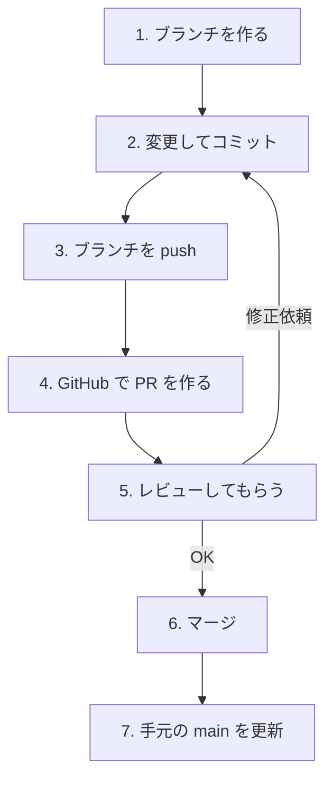

# 5. プルリクエスト

第4章では、手元で `git merge` してブランチを合流させました。チーム開発では、マージする前に **「この変更を取り込んでいいですか?」と提案して、他の人に見てもらう** のが普通です。この提案が **プルリクエスト(Pull Request, PR)** です。

## 5-1. なぜプルリクエストを使うのか

- **レビュー**: 他の人がコードを読んで、ミスや改善点を指摘できる
- **記録**: なぜこの変更をしたのか、どんな議論があったのかが残る
- **確認**: 自動テストを組み合わせれば、テストが通った変更だけをマージできる

一人で開発しているときでも、PR を使うと「どのまとまりで何をしたか」が整理されて後から追いやすくなります。

## 5-2. 全体の流れ



## 5-3. ブランチを push する

`git-practice` リポジトリで続けます。まず `main` を最新にしてからブランチを作ります。

```console
$ git switch main
$ git pull
$ git switch -c feature/add-goals
```

`goals.md` を作ってコミットします。

```markdown
# 今年の目標

- GitHub で毎週コミットする
- チーム開発を経験する
```

```console
$ git add goals.md
$ git commit -m "今年の目標を追加"
```

ブランチを GitHub に push します。

```console
$ git push -u origin feature/add-goals
```

## 5-4. プルリクエストを作る

1. GitHub のリポジトリのページを開くと、黄色い帯で **Compare & pull request** というボタンが出ているのでクリック
   - 出ていなければ、**Pull requests** タブ → **New pull request** → `compare` で `feature/add-goals` を選ぶ
2. 次を確認・入力する
   - **base: `main` ← compare: `feature/add-goals`** になっていること(「`feature/add-goals` を `main` に取り込む」という意味)
   - **タイトル**: 何をした PR か(例: 「今年の目標を追加」)
   - **説明**: 何を・なぜ変えたか、レビューしてほしい点
3. **Create pull request** をクリック

### 良い PR の説明の例

```markdown
## 概要
自己紹介ページに「今年の目標」を追加しました。

## 変更内容
- `goals.md` を新規作成

## 見てほしいところ
- 目標の書き方がわかりやすいか
```

💡 **ポイント**: 説明に `Closes #3` のように書くと、PR がマージされたときに Issue #3 が自動で閉じます(Issue は第6章で扱います)。

## 5-5. レビューする・してもらう

PR のページの **Files changed** タブで、変更内容を確認できます。

- 行番号の横の **+** をクリックすると、その行にコメントできます
- 右上の **Review changes** から、レビュー全体の結果を送れます

| 選択肢 | 意味 |
| --- | --- |
| Comment | 質問や感想(マージの可否は言わない) |
| Approve | 問題なし、マージして OK |
| Request changes | 修正してほしい |

💡 **ポイント**: 自分の PR は自分で Approve できません。一人で練習するときは、自分の PR に Comment でメモを残すだけで十分です。

### 修正を頼まれたら

同じブランチでコミットを追加して push するだけです。PR は自動で更新されます。新しく PR を作り直す必要はありません。

```console
$ git add goals.md
$ git commit -m "目標を具体的にする"
$ git push
```

### レビューするときの心がけ

- コードを批判するのであって、人を批判しない
- 「〜したほうがいい」より「〜はどうでしょう?」「〜なのはなぜですか?」
- 良いところも伝える
- 必須の指摘か、好みの問題かをはっきりさせる(好みなら頭に `nits:` や「細かいですが」とつけるなど)

## 5-6. マージする

レビューが終わったら、PR ページの下の **Merge pull request** → **Confirm merge** をクリックします。マージ後に出てくる **Delete branch** で、GitHub 上のブランチを消しておきましょう。

マージ方法は3種類から選べます。最初は既定の **Create a merge commit** で構いません。

| 方法 | 結果 |
| --- | --- |
| Create a merge commit | ブランチのコミットをそのまま残し、マージコミットを作る |
| Squash and merge | ブランチのコミットを1つにまとめてから取り込む |
| Rebase and merge | ブランチのコミットを `main` の先頭に並べ直して取り込む |

## 5-7. 手元を更新する

GitHub 上でマージしただけでは、手元の `main` は古いままです。

```console
$ git switch main
$ git pull
$ git branch -d feature/add-goals
```

これで1サイクル完了です。次の作業も、また **`main` を最新にする → ブランチを作る** から始めます。

## 🧪 やってみよう

1. `feature/add-goals` ブランチで PR を作り、自分でマージする
2. 手元の `main` を `git pull` で更新し、`goals.md` があることを確認する
3. **Files changed** タブで、自分の変更の行にコメントをつけてみる
4. (友達と一緒にやる場合)お互いのリポジトリの **Settings → Collaborators → Add people** で相手を招待し、相手のリポジトリを clone してブランチを push、PR を出す。相手はレビューして Approve してからマージする

---

[← 前へ: 4. ブランチ](04-branch.md) | [次へ: 6. Issue でやることを管理する →](06-issue.md)
