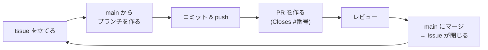

# 6. Issue でやることを管理する

## 6-1. Issue とは

**Issue** は、リポジトリごとの「やることリスト」兼「掲示板」です。

- バグの報告
- 新しい機能のアイデア
- 質問や議論

「やること」を Issue に書き出しておくと、何が残っていて誰が担当しているのかがひと目でわかります。一人で開発しているときも、自分用の TODO リストとして便利です。

## 6-2. Issue を作る

1. リポジトリの **Issues** タブ → **New issue**
2. タイトルと内容を書いて **Create**

```markdown
## やりたいこと
自己紹介ページに写真を載せたい

## 完了の条件
- [ ] 写真ファイルを追加する
- [ ] profile.md から画像を表示する
```

`- [ ]` と書くとチェックボックスになり、進み具合がわかります。

右側のメニューで、次のような情報をつけられます。

| 項目 | 使い方 |
| --- | --- |
| Assignees | 担当者 |
| Labels | 種類(`bug`、`enhancement`、`documentation` など) |

Issue にはコメントを書き込めるので、「この方法でいいかな?」といった相談もそこでできます。

## 6-3. Issue と PR をつなぐ

作った Issue には `#1`、`#2` のように番号が振られます。

- コミットメッセージや PR の説明に `#5` と書くと、その Issue へのリンクになります
- PR の説明に **`Closes #5`** と書くと、その PR がマージされたときに Issue #5 が **自動で閉じます**(`Fixes #5` や `Resolves #5` でも同じ)

これで、「なぜこの変更をしたのか(Issue)」と「実際の変更(PR)」がつながり、あとから履歴を追いやすくなります。

## 6-4. いつもの流れ

ここまでの章で学んだことをつなげると、次のような流れになります。多くのチームが使っている **GitHub Flow** という進め方です。



ルールは2つだけです。

1. **`main` は常にちゃんと動く状態に保つ**(直接コミットしない)
2. **作業は必ずブランチで行い、PR を通して `main` に入れる**

## 🧪 やってみよう

`git-practice` リポジトリで、Issue から PR までを一周してみましょう。

1. 「自己紹介に好きな言葉を追加する」という Issue を作り、Assignees に自分を設定する。Issue の番号(例: `#1`)を確認しておく
2. 手元で `main` を最新にして、ブランチを作る

   ```console
   $ git switch main
   $ git pull
   $ git switch -c feature/add-favorite-words
   ```

3. `profile.md` に好きな言葉を追加してコミットし、push する
4. PR を作り、説明に `Closes #1`(自分の Issue の番号)と書く
5. PR をマージし、Issue が自動で閉じたことを確認する
6. 手元の `main` を `git pull` で更新する

できたら、この教材は完了です 🎉
友達やサークルのメンバーと一緒にやる場合は、代表者のリポジトリにメンバーを招待して(**Settings → Collaborators → Add people**)、Issue を一人ずつ割り当てて進めてみてください。

## まとめ

- Issue は「やること」を書き出す場所
- PR の説明に `Closes #番号` と書くと、マージ時に Issue が閉じる
- **Issue → ブランチ → コミット → PR → レビュー → マージ** を繰り返して開発を進める

---

[← 前へ: 5. プルリクエスト](05-pull-request.md) | [目次に戻る](../README.md)
