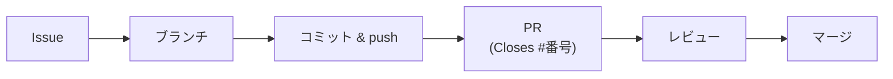

# 6. Issue

| 用語 | 意味 |
| --- | --- |
| Issue | やること・バグ・アイデアを書く場所。`#1` のように番号がつく |
| Assignees / Labels | 担当者 / 種類(`bug` など) |

## 作り方

**Issues** タブ → **New issue** で、タイトルと内容を書いて作成します。`- [ ]` と書くとチェックボックスになります。

## PR とつなぐ

PR の説明に **`Closes #番号`** と書くと、その PR をマージしたときに Issue が自動で閉じます。

## いつもの流れ(GitHub Flow)

## 🧪 やってみよう

1. Issue を作る
2. ブランチで対応してコミット・push する
3. 説明に `Closes #番号` と書いた PR を作ってマージし、Issue が閉じたことを確認する

---

[← 前へ: 5. プルリクエスト](05-pull-request.md) | [目次に戻る](../README.md)
