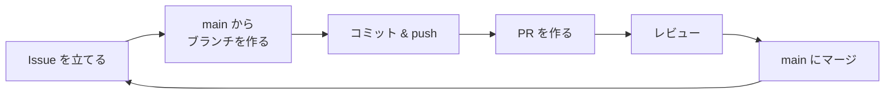
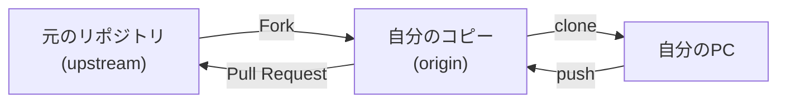

# 6. チームで開発する

## 6-1. Issue: やることを管理する

**Issue** は、リポジトリごとの「やることリスト」兼「掲示板」です。

- バグの報告
- 新しい機能のアイデア
- 質問や議論

### Issue を作る

1. リポジトリの **Issues** タブ → **New issue**
2. タイトルと内容を書いて **Create**

```markdown
## やりたいこと
自己紹介ページに写真を載せたい

## 完了の条件
- [ ] 写真ファイルを追加する
- [ ] profile.md から画像を表示する
```

`- [ ]` と書くとチェックボックスになり、進み具合がわかります。

### Issue と PR をつなぐ

- Issue には `#番号` が振られます(例: `#5`)
- コミットメッセージや PR の説明に `#5` と書くと、自動でリンクされます
- PR の説明に `Closes #5` / `Fixes #5` と書くと、その PR がマージされたときに Issue が閉じます

右側の **Assignees** で担当者、**Labels** で種類(`bug`、`enhancement` など)をつけられます。

## 6-2. GitHub Flow

多くのチームが使っている、シンプルな開発の進め方です。ここまでの章でやってきたことそのものです。



ルールは2つだけです。

1. **`main` は常に動く状態に保つ**(直接コミットしない)
2. **作業は必ずブランチで行い、PR を通して `main` に入れる**

💡 **ポイント**: リポジトリの **Settings → Rules(Rulesets)** や **Branches** で、「`main` への直接 push を禁止」「PR に Approve が1つ以上必要」などのルールを設定できます。チームで使うときはぜひ設定しましょう。

## 6-3. チームの作り方: 2つの方法

他の人のリポジトリに変更を加える方法は2つあります。

| | コラボレーター方式 | Fork 方式 |
| --- | --- | --- |
| 使う場面 | 授業のグループ、サークル、仲間内 | オープンソース、権限をもらえないリポジトリ |
| push できる場所 | 元のリポジトリに直接 | 自分のコピー(Fork)だけ |
| 準備 | 持ち主に招待してもらう | 自分で Fork ボタンを押すだけ |

## 6-4. コラボレーター方式

### 持ち主がやること

1. リポジトリの **Settings → Collaborators** → **Add people**
2. 相手のユーザー名を入力して招待する

### 招待された人がやること

1. メールか GitHub の通知から招待を承認する
2. リポジトリを clone して、ブランチを作って作業し、push して PR を出す

```console
$ git clone https://github.com/持ち主/リポジトリ名.git
$ cd リポジトリ名
$ git switch -c feature/xxx
（編集して add / commit）
$ git push -u origin feature/xxx
```

あとは第5章と同じです。

💡 **ポイント**: 複数のリポジトリやメンバーを管理したいなら、**Organization** を作るのがおすすめです(無料で作れます)。サークルやプロジェクト単位でリポジトリをまとめられ、チームごとに権限を設定できます。

## 6-5. Fork 方式

**Fork** は、他人のリポジトリを自分のアカウントにまるごとコピーする機能です。



1. 元のリポジトリのページで、右上の **Fork** → **Create fork**
2. **自分のアカウントにできた Fork** を clone する

   ```console
   $ git clone https://github.com/自分のユーザー名/リポジトリ名.git
   ```

3. ブランチを作って作業し、自分の Fork に push する
4. GitHub で自分の Fork を開くと **Contribute → Open pull request** が出るので、元のリポジトリに向けて PR を作る

### 元のリポジトリの更新を取り込む

Fork したあとに元のリポジトリが更新されたら、自分の Fork も追いつかせる必要があります。いちばん簡単なのは、GitHub で自分の Fork のページを開き、**Sync fork → Update branch** を押すことです。そのあと手元で `git pull` します。

コマンドでやる場合は、元のリポジトリを `upstream` という名前で登録しておきます。

```console
$ git remote add upstream https://github.com/元の持ち主/リポジトリ名.git
$ git switch main
$ git pull upstream main
$ git push
```

## 6-6. チーム開発のマナー

- 作業を始める前に `git pull` で最新にする
- ブランチは小さく、PR も小さく(1つの PR で1つのこと)
- `main` に直接 push しない
- 他の人のブランチを勝手に書き換えない
- **`git push --force` は使わない**(他の人の履歴を消してしまうことがあります)
- わからないことは Issue や PR のコメントで聞く

## 🧪 やってみよう

3〜4人のグループで、1つのリポジトリを育ててみましょう。

1. 代表者がリポジトリ `team-profile` を作り、メンバーをコラボレーターに招待する
2. 代表者が「メンバー全員の自己紹介ページを作る」という Issue を、メンバーごとに1つずつ立てて Assignees に担当者を設定する
3. 各メンバーは自分の名前のブランチを作り、`members/自分の名前.md` を追加して PR を出す。説明には `Closes #(自分の Issue 番号)` を書く
4. 他のメンバーの PR を最低1つレビューし、Approve する
5. 全員分マージできたら完成! Issue がすべて閉じていることを確認する

余裕があれば、全員が `README.md` の同じ場所に1行ずつ追記する PR を出して、コンフリクトの解決も体験してみてください。

---

[← 前へ: 5. プルリクエスト](05-pull-request.md) | [次へ: 7. 困ったときは →](07-troubleshooting.md)
